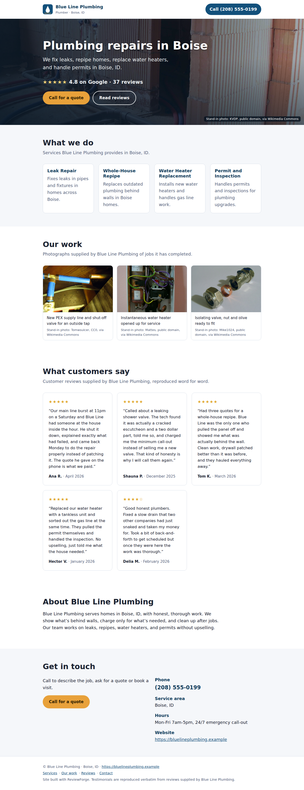

# ReviewForge

**Turn a local business's own customer reviews into a clean, honest one-page
website it owns.**

ReviewForge takes a business's details, its customer reviews and (ideally) its
own photos, and generates a fast, accessible, static website: a hero, the
services the reviews describe, verbatim attributed testimonials, a short
"about" blurb, and a clear call to phone the business. Every build also writes
a machine-readable `provenance.json` saying where each word and each image came
from.

It is built around one rule: **nothing reaches the page that the input does not
support.** It cannot guarantee that on its own, so it is also built to make a
human review easy (see [Before you publish](#before-you-publish)).

| Supplied photos (`samples/business-with-photos.json`) | Reviews only, illustrative placeholders (`samples/business.json`) |
|---|---|
|  |  |

Both sample businesses are **fictional**. See [Samples](#samples).

## What it is (and is not)

- It **is** a tool a business (or someone helping one) can use to stand up a
  simple website from reviews and photos the business already has the right to
  use.
- It is **not** a scraper. It has no code that fetches reviews or photos from
  Google, Yelp or any other platform.
- It is **not** a review generator. Testimonials are verbatim excerpts of the
  reviews you supply, with the author and rating you supply. ReviewForge cannot
  check that a supplied review is genuine; that is on whoever supplies it.
- It does **not** pass generated pictures off as the business's work. See
  [Imagery](#imagery).
- The marketing copy is **machine-drafted**. It is audited for unsupported
  claims, but it still has to be read by a human before the site goes live.

## Where reviews may come from

Use only reviews **the business has the right to republish**: reviews customers
sent the business directly, testimonials it collected with permission, or an
export from a platform whose terms allow republication.

ReviewForge deliberately has **no Google Places / Google Maps integration.** A
static site is an indefinite copy of whatever it shows, and Google's terms for
Places content do not allow storing reviews or photos like that, and serving
Places photos from a static page would put an API key in public HTML. The only compliant way to show live Google reviews is a client-side
widget that fetches them at view time under Google's terms, which is out of
scope for a static generator.

**Do not cherry-pick.** If you supply only the five best reviews out of forty,
the page will show an average of those five. ReviewForge labels that number as
"average of the 5 reviews shown" so it cannot read as the business's overall
rating, but the selection itself is still yours to answer for. If the business
has an overall rating on a platform, supply it as `rating_summary` and the hero
shows that instead (e.g. "4.6 on Google · 40 reviews").

## Copy that cannot over-claim (much)

Models invent credentials even when told not to; a 7B model wrote *"With over
20 years of experience"* for a business whose input says nothing about its age.
So every generated field is audited before it reaches the page. The audit looks
for:

- years in business, decades, founding years;
- licensing, insurance, bonding, certification, OSHA, BBB / A+ ratings;
- awards and rankings: *best*, *leading*, *premier*, *top-rated*, *#1*;
- expertise and reputation puffery: *expert*, *experienced*, *professional*,
  *trusted*, *reliable*, *high-quality*;
- availability: *24/7*, *emergency*, *same-day*;
- ownership: *family-owned*, *locally owned*, *veteran-/woman-owned*,
  *third-generation*;
- *eco-friendly*, *lowest price*, *price match*, *affordable*;
- guarantees, warranties, *lifetime*;
- percentages, star ratings, *hundreds / thousands / dozens*, and any number of
  three or more digits;
- the word **free** — see below.

A flagged phrase is allowed only if the same words appear in the business's own
facts or reviews: if a customer wrote "30 years", the copy may say "30 years".
If anything is unsupported, the draft is discarded and the model gets **one
retry**, told exactly which phrases were rejected. If the retry also fails, a
plain deterministic template is used instead (the template itself is tested
against the same audit for many categories). `provenance.json` records every
attempt and every rejected phrase.

**Be clear about what this check is.** It is a conservative pattern match plus a
case-insensitive whole-phrase lookup in the input (allowing a simple
singular/plural, so a review saying "emergency" supports "emergencies"). It stops the copy introducing
claims the input never mentions; it does **not** prove anything true. A review
saying "not the best" would "support" the word *best*. Mild, unlisted adjectives
get through. A human still has to read the page.

### "Free" is opt-in

ReviewForge never assumes a business gives anything away. The words "free
estimate" / "free quote" (or "free" anywhere in the copy) appear only when
`business.json` sets `"offers_free_estimates": true`. Otherwise the calls to
action are neutral ("Call for a quote"). A review that mentions something free
does not count: it describes one customer's experience, not an offer.

## Imagery

**A trade website lives or dies on its pictures, and the pictures that sell
work are photographs of the work.** Put the business's own photos in
`business.json`: the hero photo (the first, or the one with `"role": "hero"`)
fills the top of the page and the rest become an "Our work" gallery, with the
business's own captions kept word for word.

| Source | `origin` | Where it is used |
|---|---|---|
| Photos the business supplied | `supplied` | hero + "Our work" gallery, captions verbatim |
| Generated generic trade imagery | `generated` | hero backdrop + service cards only |

Generated imagery is a **placeholder, not a finished product**, and the rules
for it are enforced in code:

- **Disclosed on the page.** Whenever generated imagery is used, the footer
  states that the images are software-generated placeholders, not photographs
  of the business's work, and each such `` has a
  `data-illustrative="true"` attribute.
- **Never in "Our work".** The gallery renders only business-supplied photos;
  this is filtered in both the generator and the renderer.
- **No ownership captions.** `is_business_own` is derived from `origin` and
  cannot be overridden. A caption or alt text on a generated image that implies
  the business did the work ("our crew", "recent job", "this home") is stripped
  and recorded in `provenance.json`.
- **Generic by construction.** Prompts describe materials, tools and distant,
  unidentifiable work; the negative prompt rejects text, signage, house
  numbers, plates, logos and faces.
- **No embedded metadata.** Generators such as ComfyUI write their whole
  workflow into PNG text chunks. Every image written to the output has its
  PNG `tEXt`/`iTXt`/`zTXt`/`eXIf`/`tIME` chunks or JPEG EXIF/XMP/IPTC/comment
  segments removed (standard library only); the generation details live in
  `provenance.json` instead. This also strips GPS data from phone photos — note
  that it drops the EXIF orientation flag too, so supply photos upright.
- **No logo is ever generated.** A supplied logo is used as-is; otherwise the
  page shows a typographic wordmark.
- **A missing photo is an error**, never silently replaced with a generated
  one.

Why generated imagery is only a stopgap: it is not the business's work and
never will be; visitors may assume otherwise even with the labels; some
jurisdictions treat implying work you have not done as misleading advertising;
and generative models produce artefacts. Look at every image, and ask the owner
for five phone photos. `--images own-only` forbids generated imagery outright;
`--images off` disables imagery entirely.

### Where generation runs

ReviewForge does not ship a diffusion pipeline; it drives one you already run:

- **`ComfyUIBackend`** (default) — a running
  [ComfyUI](https://github.com/comfyanonymous/ComfyUI) over its HTTP API
  (`POST /prompt` → poll `/history/<id>` → `/view`), standard library only and
  core nodes only. Point it anywhere with `--comfyui` /
  `REVIEWFORGE_COMFYUI_URL`; pick the checkpoint with `--image-checkpoint` /
  `REVIEWFORGE_IMAGE_CHECKPOINT` (default `sd_xl_base_1.0.safetensors`; if the
  server lacks it, an SDXL checkpoint it has is used and the substitution
  recorded).
- **`DiffusersScriptBackend`** (optional) — your own local `diffusers` worker
  script, via `REVIEWFORGE_DIFFUSERS_SCRIPT` and `--image-backend diffusers`.

If neither is reachable the page is built without imagery and
`provenance.json` says why. ReviewForge is written to be a polite guest on a
shared ComfyUI: it queues the whole image set at once (so it renders as one
block instead of waiting behind every job that arrives in between), treats a
missed status poll from a busy server as a hiccup rather than a failure,
withdraws its own queued prompt when it gives up on it (never touching anyone
else's job), and notices within seconds if a restart dropped the queue, then
retries that image once. Allow for queueing with `--image-timeout`.

**Privacy.** Anything `provenance.json` records about the machines involved is
minimal: an LLM or ComfyUI endpoint is recorded only if it is a loopback
address (otherwise just "non-local endpoint"), the server's checkpoint list is
not recorded, and only the *number* of compute devices is noted.

## Legal pages

Many jurisdictions require a business website to carry a legal notice and a
privacy policy. Supply them as text or as URLs:

```json
"country": "DE",
"legal": {
  "impressum": "Muster Sanitär GmbH\nMusterstraße 1\n10115 Berlin\n...",
  "privacy": "https://example.com/datenschutz"
}
```

Text is rendered in a section at the foot of the page; URLs are linked. The
footer links read **Impressum / Datenschutz** for Germany and **Legal notice /
Privacy** elsewhere.

- **`country: "DE"` without both an Impressum and a privacy policy is a hard
  error** — the build stops and writes nothing.
- Other EU/EEA countries missing either get a warning (printed, and recorded in
  `provenance.json`).
- ReviewForge writes no legal text for you and gives no legal advice. Also note
  that a static page with no forms, cookies, fonts or third-party scripts — which
  is what ReviewForge emits — keeps the privacy policy simple, but your hosting
  provider's access logs still count.

## Before you publish

Copy is machine-drafted and **must be reviewed by a person before the site goes
live.** A short checklist:

1. **Read every sentence** of the hero, services and about text against what the
   business actually does. Remove any service it does not offer and any
   adjective you cannot stand behind. Check `provenance.json` →
   `rejected_claims` to see what the model tried to say.
2. **Reviews:** confirm the business has the right to republish each one, that
   none was edited, and that the selection is fair (not just the top few).
3. **Rating:** if the hero shows a platform rating, check it matches the
   platform today.
4. **Offers:** confirm `offers_free_estimates` is right. Phone number, hours and
   service area are correct.
5. **Images:** every photo really is the business's own work (or is clearly
   labelled illustrative); no faces, addresses or plates of customers without
   consent. Replace generated placeholders with real photos as soon as possible.
6. **Legal:** Impressum / privacy policy present where required.
7. **Ownership:** the business should own its **domain** and its **hosting**
   account (or at least have the login), so the site is not held hostage by
   whoever built it. The output is plain static files; any static host works.

## Install

Pure standard library at runtime — no third-party dependencies. Python 3.10+.

```bash
pip install -e .           # installs the `reviewforge` command
pip install -e ".[test]"   # + pytest for the test suite
```

## Usage

```bash
# Preferred: the business's own photos, listed in business.json
reviewforge build --input samples/business-with-photos.json --out out-photos/

# No photos? Generic illustrative placeholders from a local ComfyUI
reviewforge build -i samples/business.json -o out/ --images illustrative

# Never show imagery the business did not supply
reviewforge build -i samples/business.json -o out/ --images own-only

# Check the LLM endpoint and the image backend
reviewforge check
```

| Flag | Default | Meaning |
|------|---------|---------|
| `--input` / `-i` | — | path to the business JSON |
| `--out` / `-o` | — | output directory |
| `--model` | `qwen2.5-coder:32b` | Ollama model for copy generation |
| `--endpoint` | `http://localhost:11434` | Ollama base URL |
| `--timeout` | `120` | LLM request timeout (seconds) |
| `--images` | `auto` | `auto` \| `own-only` \| `illustrative` \| `off` |
| `--image-backend` | `auto` | `auto` \| `comfyui` \| `diffusers` |
| `--comfyui` | `http://127.0.0.1:8188` | ComfyUI base URL |
| `--image-checkpoint` | `sd_xl_base_1.0.safetensors` | checkpoint to generate with |
| `--service-images` | `3` | how many illustrative service images to make |
| `--image-seed` | fixed | seed, for reproducible imagery |
| `--image-timeout` | `1800` | seconds to wait for one generated image |

`--images auto` uses the business's photos if it has any and generates
placeholders only if it supplied none; it does not contact an image backend
when photos are present. If the LLM is unreachable, the deterministic template
is used and the build still succeeds. For any **qwen3** model, `think:false` is
sent automatically (otherwise it returns empty output).

### Input format (`business.json`)

```jsonc
{
  "name": "Summit Ridge Roofing",
  "category": "Roofing Contractor",
  "city": "Asheville, NC",
  "phone": "(828) 555-0147",
  "website": "https://example.com",              // optional
  "hours": "Mon-Fri 7:30am-6pm",                 // optional
  "offers_free_estimates": false,                // optional, default false
  "rating_summary": {                            // optional
    "average": 4.6, "count": 40, "platform": "Google"
  },
  "country": "US",                               // optional, ISO 3166-1 alpha-2
  "legal": { "impressum": "...", "privacy": "https://..." },  // optional*
  "logo": { "src": "photos/logo.png", "alt": "Summit Ridge Roofing logo" },
  "photos": [                                    // optional, strongly preferred
    { "src": "photos/roof-1.jpg",
      "role": "hero",                            // optional
      "alt": "New architectural shingles on a two-storey home",
      "caption": "Full tear-off and re-shingle in West Asheville",
      "attribution": "Photo: J. Smith" }         // optional credit line
  ],
  "reviews": [
    { "author": "Marcus D.", "rating": 5, "text": "...",
      "date": "March 2026",                      // optional
      "source_url": "https://..." }              // optional, kept in provenance
  ]
}
```

\* required (both keys) when `country` is `"DE"`.

Required business fields: `name`, `category`, `city`, `phone`. Required per
review: `author`, `rating` (0–5), `text`. Required per photo: `src` (a local
path, absolute or relative to the JSON file, or an `http(s)` URL that is
referenced, never downloaded). Missing optional fields are omitted, never
invented; a malformed review, rating summary or photo entry is rejected loudly.

### Output

- `index.html` — semantic, responsive, no JavaScript, no trackers, no external
  fonts or CDNs; skip link, landmarks, `tel:` links, focus styles, dark mode.
  The `provenance.json` record is embedded too.
- `style.css` — one hand-written stylesheet.
- `images/` — staged copies of supplied photos and/or generated placeholders,
  metadata stripped.
- `provenance.json` — copy source and every attempt, rejected claims, which
  reviews became testimonials (with `source_url`), the basis of the displayed
  rating, legal-page status, and every image with its origin, illustrative
  flag, alt text, and (if generated) prompt and seed.

## Samples

Both sample businesses are **fictional** — invented names, made-up reviews,
`555` phone numbers and `.example` domains.

- `samples/business.json` → `out/`: **Summit Ridge Roofing**, reviews only,
  built with `--images illustrative` to show the placeholder path (the
  footer discloses the generated imagery). No `rating_summary`, so the hero
  shows the average of the reviews shown.
- `samples/business-with-photos.json` → `out-photos/`: **Blue Line Plumbing**,
  the supplied-photos path (hero, gallery, logo, captions, a `rating_summary`).
  Its photos are **openly licensed stand-ins from Wikimedia Commons**, not
  photographs of any plumber's work, and each is credited on the page:

  | File | Author | Licence | Source |
  |---|---|---|---|
  | `bathroom-rough-in.jpg` | KVDP | Public domain | [File:ShowerInstallation.JPG](https://commons.wikimedia.org/wiki/File:ShowerInstallation.JPG) |
  | `pex-supply-line.jpg` | Tomwsulcer | CC0 1.0 | [File:PEX pipes and valves in basement ceiling for exterior water spigot.jpg](https://commons.wikimedia.org/wiki/File:PEX_pipes_and_valves_in_basement_ceiling_for_exterior_water_spigot.jpg) |
  | `water-heater.jpg` | Mattes | Public domain | [File:Water heater bathroom.JPG](https://commons.wikimedia.org/wiki/File:Water_heater_bathroom.JPG) |
  | `isolating-valve.jpg` | Mike1024 | Public domain | [File:Compression fitting isolating valve 15mm screwdriver turn.jpg](https://commons.wikimedia.org/wiki/File:Compression_fitting_isolating_valve_15mm_screwdriver_turn.jpg) |

  The logo is a simple mark drawn for the fictional business.

Both sample builds were produced with `qwen3:30b-a3b-instruct-2507-q4_K_M` through
Ollama. The
`preview.png` in each output folder is a full-page screenshot.

## Tests

```bash
pytest -q
```

The suite runs offline. It covers: input parsing and its refusals; the claim
audit (the full vocabulary, support from reviews, "free" gating, the
retry-then-fallback path, and the fallback passing its own audit across
categories); footer and testimonial wording; the rating basis; legal-page
handling including the German hard stop; the footer disclosure for generated
imagery; metadata stripping for PNG and JPEG; the image honesty rules (gallery
exclusion, caption stripping, unforgeable `is_business_own`); the ComfyUI
backend's failure modes against a local fake server; and a check that no
Places / key-in-URL code remains. `tests/conftest.py` points the image backend
at an unroutable address so no test can start a real GPU render.

## License

MIT — see [LICENSE](LICENSE).
